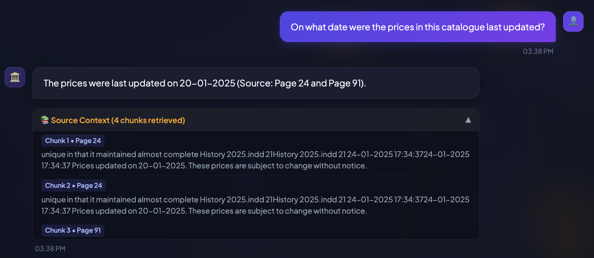
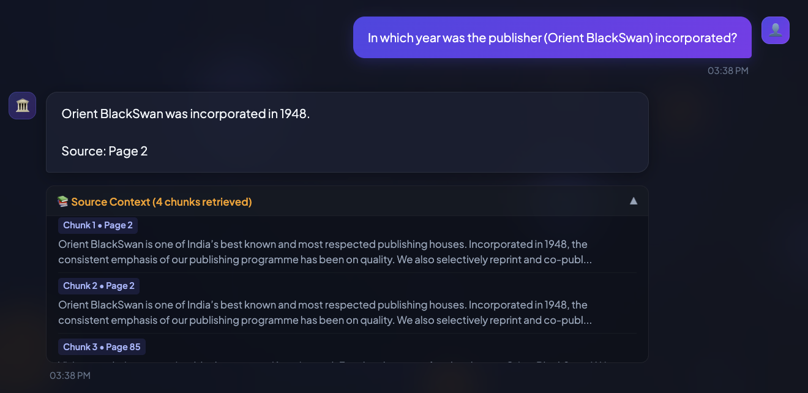
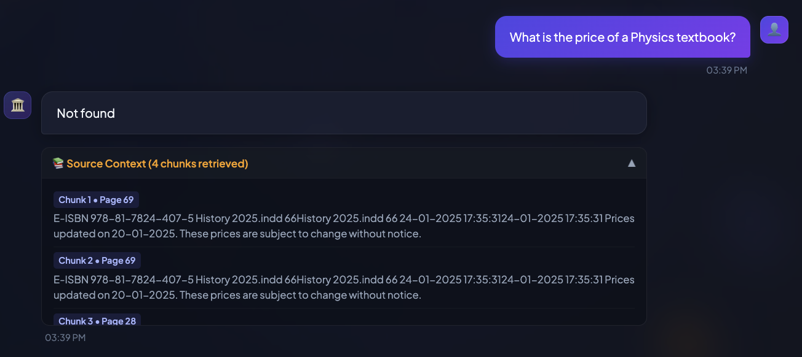
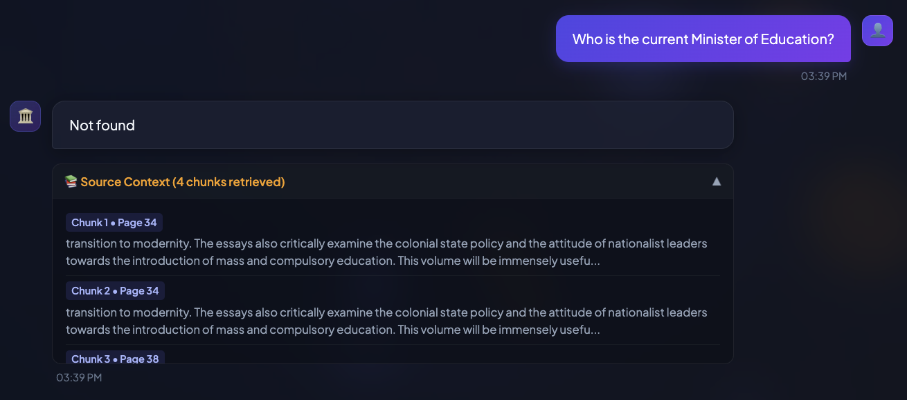
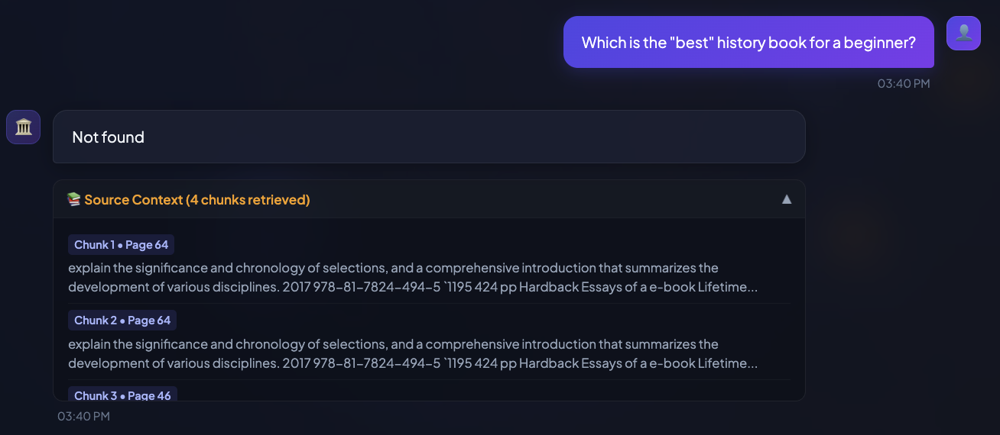

# 🏛️ Orient BlackSwan History Bot (Project 4)

A Retrieval-Augmented Generation (RAG) application built with Python, LangChain, ChromaDB, and FastAPI, with a browser chat interface. It answers questions from the *Orient BlackSwan History catalogue (2024–25)*, gives page references for each answer, and replies **"Not found"** when the answer is not in the document.

---

## 🚀 System Architecture & Flow

The project has three parts:

1. **Data Ingestion (`ingest.py`)**
   * Loads `History_2024-25.pdf` with LangChain's `PyPDFLoader`.
   * Splits the text into 500-character chunks with 50 characters of overlap, using `RecursiveCharacterTextSplitter`.
   * Creates embeddings with HuggingFace `all-MiniLM-L6-v2` and saves them to a local Chroma database in `history_db/`.

2. **Backend Server (`server.py`)**
   * A FastAPI app. The RAG chain loads once at startup.
   * For each question, the retriever fetches the top 4 matching chunks from Chroma.
   * A system prompt tells the LLM to answer only from those chunks, to cite the page, and to reply "Not found" if the answer is missing.
   * `POST /ask` returns the answer along with the retrieved chunks.

3. **Frontend (`index.html`)**
   * A single-file chat interface served by the backend at `http://localhost:8000`.
   * Sends questions to `/ask`, shows the answer with its source page, and lets you expand the retrieved chunks.

**Question flow:** Question → embed → search Chroma (top 4) → build prompt with context → LLM → answer with page reference (or "Not found").

---

## 📁 Project Structure

| File / Folder | Purpose |
|---|---|
| `History_2024-25.pdf` | Source catalogue (91 pages) |
| `ingest.py` | Builds the Chroma vector database |
| `history_db/` | Saved vector database (already included) |
| `server.py` | FastAPI backend and `/ask` endpoint |
| `query_history.py` | Command-line version of the chatbot |
| `index.html` | Browser chat interface |
| `assets/` | Screenshots used in this README |
| `.env` | Your API key (not committed; listed in `.gitignore`) |

---

## 📋 The 5 Catalogue Questions & Answers

| Q# | Question | Answer Generated | Source Reference |
|---|---|---|---|
| **1** | On what date were the prices in this catalogue last updated? | The prices were last updated on 20–01–2025. | Page 24 and Page 91 |
| **2** | In which year was the publisher (Orient BlackSwan) incorporated? | Orient BlackSwan was incorporated in 1948. | Page 2 |
| **3** | What is the price of a Physics textbook? | Not found | Not in the catalogue (guardrail) |
| **4** | Who is the current Minister of Education? | Not found | Not in the catalogue (guardrail) |
| **5** | Which is the "best" history book for a beginner? | Not found | Subjective; no grounded answer (guardrail) |

---

## 📸 Screenshots & Execution Results

### 1. Factual Lookups (Questions 1 & 2)
*Exact catalogue update date and publisher history, with page citations.*




---

### 2. Guardrail Enforcement (Questions 3, 4 & 5)
*Out-of-document and subjective questions return "Not found".*





---

## 🛠️ How to Run Locally

### Requirements
* Python 3.10 or newer
* An API key from one of: Google Gemini, Groq, or OpenAI

### 1. Clone the repository

```bash
git clone https://github.com/anushkasingh-commits/GenAI-Project_4-Orient_BlackSwan_History_Bot.git
cd GenAI-Project_4-Orient_BlackSwan_History_Bot
```

### 2. Create a virtual environment (recommended)

```bash
python -m venv .venv
```

Activate it:

* macOS / Linux: `source .venv/bin/activate`
* Windows: `.venv\Scripts\activate`

### 3. Install the dependencies

```bash
pip install fastapi uvicorn pydantic python-dotenv langchain langchain-community langchain-text-splitters langchain-chroma langchain-huggingface langchain-google-genai pypdf sentence-transformers
```

Notes:
* `sentence-transformers` installs PyTorch, so the first install is large.
* If you use Groq or OpenAI instead of Gemini, install `langchain-groq` or `langchain-openai` in place of `langchain-google-genai`.

### 4. Add your API key

Create a file named `.env` in the project folder:

```
GOOGLE_API_KEY=your_key_here
```

You can also use `GEMINI_API_KEY`, `GROQ_API_KEY`, or `OPENAI_API_KEY`. The server uses the first key it finds, in that order: Google, Groq, then OpenAI.

### 5. Build the vector database (optional)

The repository already includes a built `history_db/`, so you can skip this step. To rebuild it from the PDF:

```bash
rm -rf history_db        # Windows: rmdir /s /q history_db
python ingest.py
```

Delete the old folder first. Otherwise the chunks are added a second time and every search returns duplicates.

### 6. Start the server

```bash
uvicorn server:app --reload
```

Then open:

* **Chat interface:** http://localhost:8000
* **API docs (Swagger):** http://localhost:8000/docs
* **Health check:** http://localhost:8000/health

### 7. Ask a question

Type a question in the chat window, or send a request to the API:

```bash
curl -X POST http://localhost:8000/ask \
  -H "Content-Type: application/json" \
  -d '{"question": "In which year was the publisher (Orient BlackSwan) incorporated?"}'
```

### Optional: command-line version

```bash
python query_history.py
```

This opens a menu where you can run the built-in sample questions or type your own.

---

## 🧰 Troubleshooting

| Problem | Fix |
|---|---|
| `No API key configured` | Create `.env` in the project folder with one of the keys in step 4, then restart the server. |
| `ModuleNotFoundError` | Re-run the install command in step 3 inside your active virtual environment. |
| `Chroma vector store not found` | Run `python ingest.py` from the project folder. |
| Answers repeat the same chunk | Rebuild the database (step 5) after deleting `history_db/`. |
| Chat page says the API is offline | Make sure the server is running on port 8000 and open http://localhost:8000, not the HTML file directly. |
